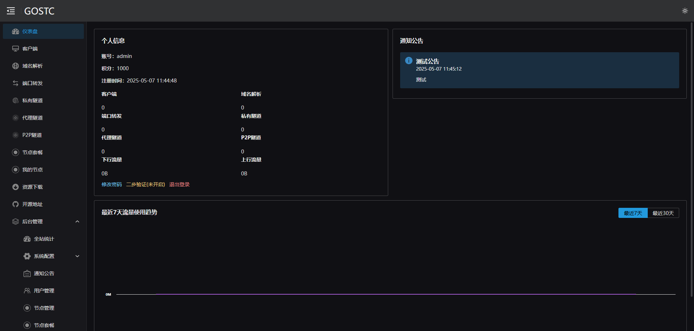
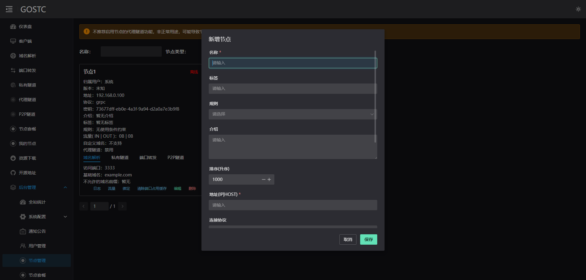
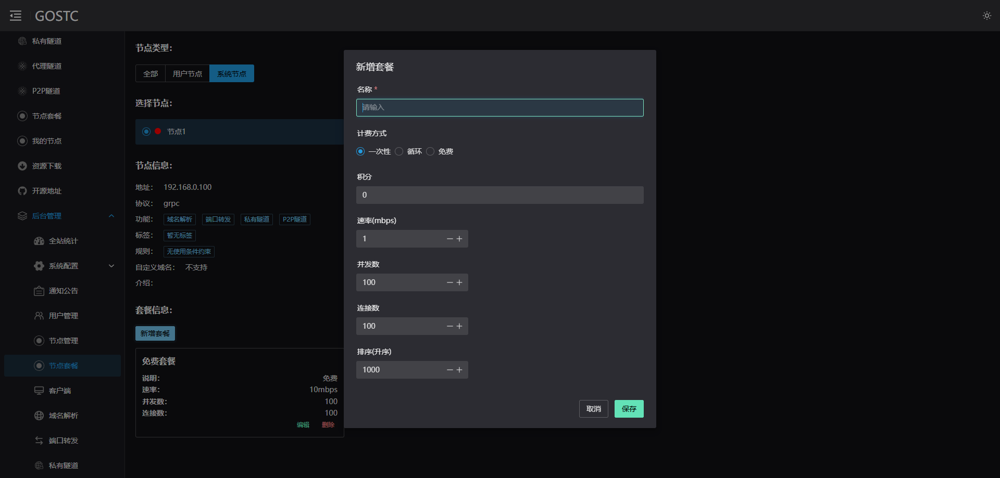

# GOSTC

[中文](README.zh-CN.md) | English

An intranet penetration management platform built on FRP. It supports multiple users and multiple nodes, rate limiting, centralized configuration, and web-based management with changes applied in real time.

**Current platform: <https://gostc.linux66.cn/>**

## Features

- Multi-user, multi-node management
- Five tunnel types: private tunnel (TCP/UDP), port forwarding, domain resolution (HTTP/HTTPS), proxy tunnel (SOCKS5), and P2P
- Node load monitoring: real-time client / tunnel / connection counts per node
- Per-node tunnel capacity limits to prevent users from crowding onto a single node
- Traffic quotas and rate limiting per tunnel / user group
- Centralized configuration, edited on the web and applied in real time

## Preview







## Documentation

Detailed guides: <https://gostc.linux66.cn/docs/>

## Directory Structure

```text
-- /
    -- server   // backend code
    -- web      // frontend code
    -- client   // node and client code
    -- proxy    // gateway service, mainly for custom domains
```

## Build the Frontend

```shell
cd web
npm i
npm run build
```

The output is in `web/dist`. Zip the `dist` directory and copy it to `server/web/dist.zip` (entry names must use forward slashes, e.g. `dist/index.html`).

## Build the Backend

```shell
cd server
go build -ldflags "-s -w" -o server main.go
```

## Build the Node / Client

Current platform:

```shell
cd client
go build -ldflags "-s -w" -o gostc ./cli/
```

Cross-platform builds (with goreleaser):

```shell
cd client
goreleaser release --snapshot --clean
```

Windows GUI client:

```shell
cd client
go build -ldflags="-H windowsgui -w -s" -o gostc-gui.exe ./gui/
```

## Run the Server

```shell
./server
```

Default port: `8080`. Default account / password: `admin/admin`.

Program directory: `/usr/local/gostc-admin/`
Data directory: `/usr/local/gostc-admin/data/`

Manage the server service:

```shell
systemctl start gostc-admin    # start
systemctl stop gostc-admin     # stop
systemctl restart gostc-admin  # restart
systemctl status gostc-admin   # status
```

Uninstall the server:

```shell
/usr/local/gostc-admin/server service uninstall
rm -rf /usr/local/gostc-admin/server
```

## Connect a Client / Node to the Server

```shell
# node
./gostc -addr gostc.linux66.cn -s -key ******

# client
./gostc -addr gostc.linux66.cn -key ******
```

For a self-hosted server without SSL, set `--tls=false` and point `-addr` to your own server, e.g.:

```shell
./gostc --tls=false -addr 127.0.0.1:8080 -s -key ******
```

- `--tls`: set according to whether the server uses SSL
- `-addr`: the server address
- `-key`: the connection key of the client or node
- `-s`: run in node mode

## Register as a Service

```shell
gostc install --tls=false -addr 127.0.0.1:8080 -key ******     # client
gostc install --tls=false -addr 127.0.0.1:8080 -s -key ******  # node
# after install, start it with: systemctl start gostc
```

Manage the service:

```shell
systemctl start gostc    # start
systemctl stop gostc     # stop
systemctl restart gostc  # restart
systemctl status gostc   # status
```

To change the key, uninstall the service first and register again:

```shell
gostc uninstall
gostc install --tls=false -addr 127.0.0.1:8080 -s -key ******
```

Uninstall the client / node binary:

```shell
rm -rf /usr/local/bin/gostc
```

**Note: because the service name is fixed, you cannot run multiple clients/nodes as services at the same time. To run several instances, use a process manager such as pm2 or supervisor.**
