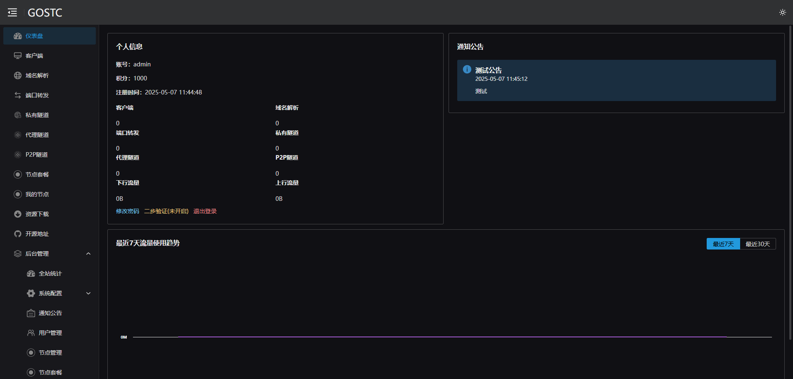
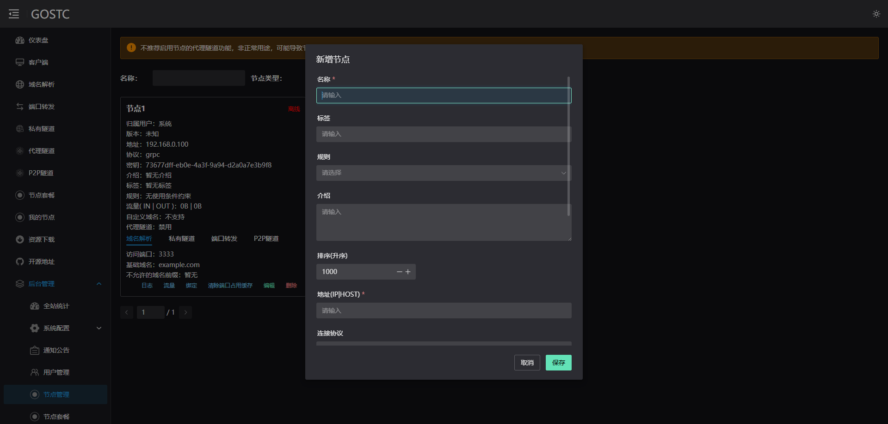
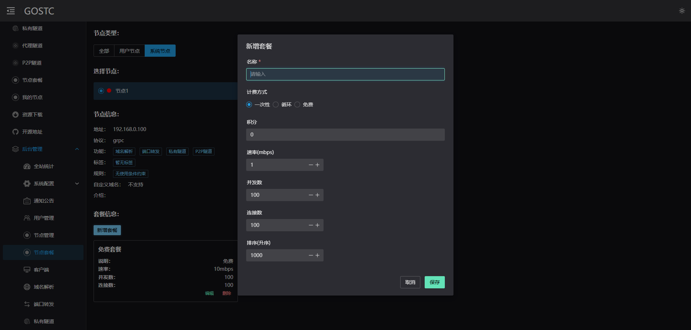

# GOSTC

中文 | [English](README.md)

基于 FRP 开发的内网穿透管理平台，支持多用户、多节点，支持速率限制，中心化配置，通过网页修改配置，实时生效。

**当前平台地址：<https://gostc.shop/>**

## 功能特性

- 多用户、多节点管理
- 五种隧道类型：私有隧道（TCP/UDP）、端口转发、域名解析（HTTP/HTTPS）、代理隧道（SOCKS5）、P2P
- 节点负载监控：实时展示每个节点的客户端数、运行隧道数、连接数
- 节点隧道数量上限，避免大量用户挤占同一节点
- 按隧道/用户组设置流量配额与速率限制
- 中心化配置，网页修改，实时生效

## 预览







## 文档

详细教程：<https://gostc.shop/docs/>

## 安装部署

提供两种方式：**一键脚本安装（Linux）** 和 **Docker Compose 安装**。安装包与镜像均由本仓库发布：[GitHub Releases](https://github.com/PonChunhui/gostc-open/releases) / [Docker Hub](https://hub.docker.com/u/adonis996)。

### 方式一：一键脚本安装（Linux）

脚本自动识别系统架构，从 GitHub Releases 下载最新发行版并安装。依赖 `bash`、`curl`、`sudo`、`tar`/`unzip`。

**安装管理端（服务端）：**

```shell
curl -fsSL https://raw.githubusercontent.com/PonChunhui/gostc-open/main/install.sh | bash -s -- server
```

- 安装到 `/usr/local/gostc-admin/`，并自动注册 systemd 服务 `gostc-admin`
- 启动：`systemctl start gostc-admin`，浏览器访问 `http://服务器IP:8080`，默认账号密码 `admin/admin`
- 数据目录：`/usr/local/gostc-admin/data/`（配置、SQLite 数据库、日志）

**安装客户端/节点：**

```shell
curl -fsSL https://raw.githubusercontent.com/PonChunhui/gostc-open/main/install.sh | bash -s -- gostc
```

脚本只把二进制安装到 `/usr/local/bin/gostc`，连接服务端需手动执行：

```shell
# 客户端（运行在被访问的内网机器上）
gostc -addr gostc.shop -key 连接密钥

# 节点（运行在公网机器上，-s 为节点模式）
gostc -addr gostc.shop -s -key 节点密钥

# 自建服务端未启用 SSL 时
gostc --tls=false -addr 服务器IP:8080 -key 连接密钥
```

注册为系统服务见下文「将客户端/节点注册为服务」一节。

也可以下载 [install.sh](install.sh) 到本地后执行 `bash install.sh server` 或 `bash install.sh gostc`。

### 方式二：Docker Compose 安装

本仓库发布的镜像（打 tag 发布时由 CI 自动构建推送）：

| 镜像 | 说明 | 架构 |
| --- | --- | --- |
| `adonis996/gostc-admin` | 管理端（服务端） | amd64 / arm64 |
| `adonis996/gostc` | 客户端 / 节点 | 386 / amd64 / armv7 / arm64 / s390x |
| `adonis996/gostc-proxy` | 网关服务（自定义域名，可选） | 386 / amd64 / armv7 / arm64 / s390x |

标签规则：稳定版同时发布 `latest` 和版本号标签（如 `2.0.12`）；预发布版（rc/beta）只发布版本号标签，不覆盖 `latest`。

**1. 部署管理端**

创建 `docker-compose.yml`（仓库根目录已提供现成模板 [docker-compose.yml](docker-compose.yml)）：

```yaml
services:
  gostc-admin:
    image: adonis996/gostc-admin:latest
    container_name: gostc-admin
    restart: unless-stopped
    ports:
      - "8080:8080"
    volumes:
      - ./data:/app/data
```

```shell
docker compose up -d
```

- 访问 `http://服务器IP:8080`，默认账号密码 `admin/admin`
- `./data` 持久化配置与数据库：`config.yaml`（首次运行自动生成）、`data.db`（SQLite）、日志
- 可用环境变量 `GOSTC_ADMIN_ADDR` 覆盖监听地址（如 `0.0.0.0:9090`，需同步修改端口映射）
- 生产环境建议前置 Nginx/Caddy 启用 HTTPS；客户端连接未启用 SSL 的自建服务端时需加 `--tls=false`

**2. 部署客户端/节点**

在被访问的内网机器（客户端）或公网机器（节点）上运行：

```yaml
services:
  gostc:
    image: adonis996/gostc:latest
    container_name: gostc
    restart: unless-stopped
    network_mode: host
    command: ["-addr", "gostc.shop", "-key", "连接密钥"]
```

- 节点模式：`command` 中追加 `"-s"`，并使用节点密钥
- 自建服务端未启用 SSL：`command: ["--tls=false", "-addr", "服务器IP:8080", "-key", "连接密钥"]`
- `network_mode: host` 让容器直接使用宿主机网络，便于访问内网目标服务，建议保留
- 连接密钥在网页「客户端 → 连接密钥」获取；节点密钥在管理端节点管理中获取

**3. （可选）部署网关服务**

`gostc-proxy` 用于实现自定义域名功能，部署在节点上，占用 80/443 端口：

```yaml
services:
  gostc-proxy:
    image: adonis996/gostc-proxy:latest
    container_name: gostc-proxy
    restart: unless-stopped
    network_mode: host
    volumes:
      - ./proxy-data:/app/data
```

首次运行自动生成 `data/config.yaml`（默认 HTTP 80 / HTTPS 443），详细说明见[文档](https://gostc.shop/docs/)。

## 目录结构

```text
-- /
    -- server   // 后端项目代码
    -- web      // 前端项目代码
    -- client   // 节点和客户端项目代码
    -- proxy    // 网关服务，主要实现自定义域名功能
```

## 编译前端代码

```shell
cd web
npm i
npm run build
```

编译后的文件在 `web/dist` 目录中，压缩 dist 目录，将 dist.zip 复制到 `server/web/dist.zip`（压缩包内条目路径需使用正斜杠，如 `dist/index.html`）。

## 编译后端代码

```shell
cd server
go build -ldflags "-s -w" -o server main.go
```

## 编译节点/客户端

当前平台：

```shell
cd client
go build -ldflags "-s -w" -o gostc ./cli/
```

多平台编译（借助 goreleaser 工具）：

```shell
cd client
goreleaser release --snapshot --clean
```

Windows GUI 客户端：

```shell
cd client
go build -ldflags="-H windowsgui -w -s" -o gostc-gui.exe ./gui/
```

## 运行后台管理（服务端）

```shell
./server
```

默认端口：`8080`，默认账号密码：`admin/admin`。

程序目录：`/usr/local/gostc-admin/`
数据目录：`/usr/local/gostc-admin/data/`

管理服务：

```shell
systemctl start gostc-admin    # 启动
systemctl stop gostc-admin     # 停止
systemctl restart gostc-admin  # 重启
systemctl status gostc-admin   # 查看状态
```

服务端卸载：

```shell
/usr/local/gostc-admin/server service uninstall
rm -rf /usr/local/gostc-admin/server
```

## 客户端和节点如何指定服务端地址

```shell
# 节点
./gostc -addr gostc.shop -s -key ******

# 客户端
./gostc -addr gostc.shop -key ******
```

如果自建的后台管理服务不启用 SSL，需要设置 `--tls=false`，并将 `-addr` 指向实际的服务端地址，例如：

```shell
./gostc --tls=false -addr 127.0.0.1:8080 -s -key ******
```

- `--tls`：根据服务端是否使用 SSL 设置
- `-addr`：服务端访问地址
- `-key`：客户端或节点的连接密钥
- `-s`：以节点模式运行

## 将客户端/节点注册为服务

```shell
gostc install --tls=false -addr 127.0.0.1:8080 -key ******     # 客户端
gostc install --tls=false -addr 127.0.0.1:8080 -s -key ******  # 节点
# install 后，需要 systemctl start gostc 启动服务
```

管理服务：

```shell
systemctl start gostc    # 启动
systemctl stop gostc     # 停止
systemctl restart gostc  # 重启
systemctl status gostc   # 查看状态
```

如需更换密钥，需要先卸载服务，然后重新注册：

```shell
gostc uninstall
gostc install --tls=false -addr 127.0.0.1:8080 -s -key ******
```

客户端/节点卸载：

```shell
rm -rf /usr/local/bin/gostc
```

**注意：由于服务名称重复，无法同时运行多个客户端/节点服务，如需启动多个实例，请通过 pm2、supervisor 等进程管理工具启动。**
