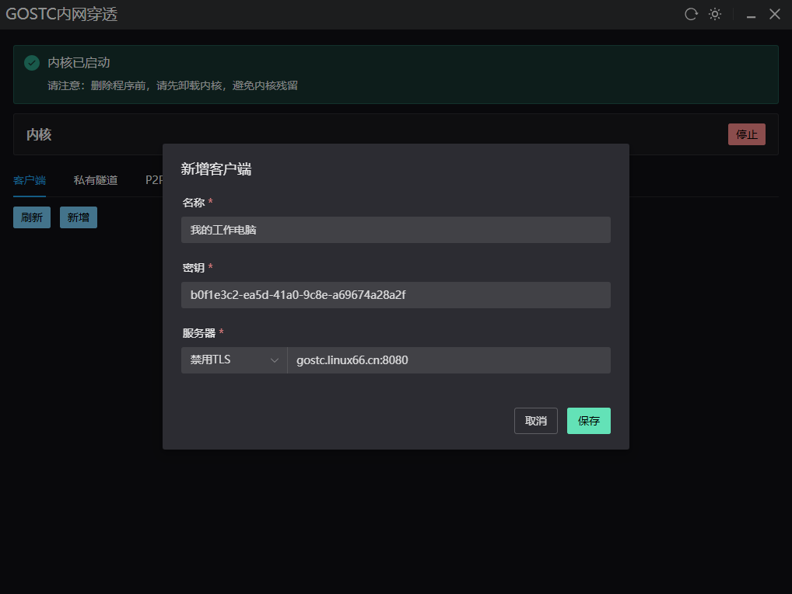
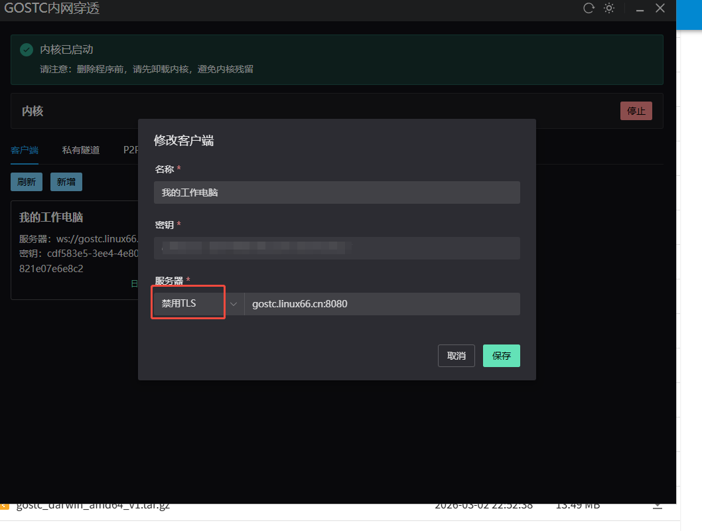
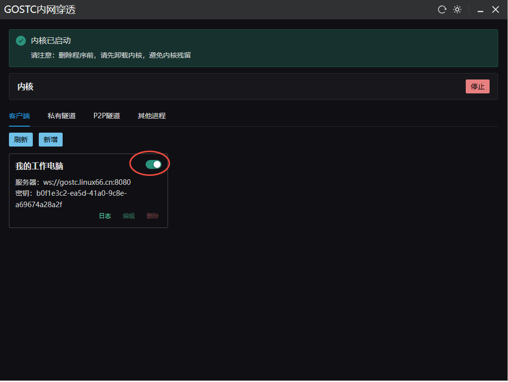
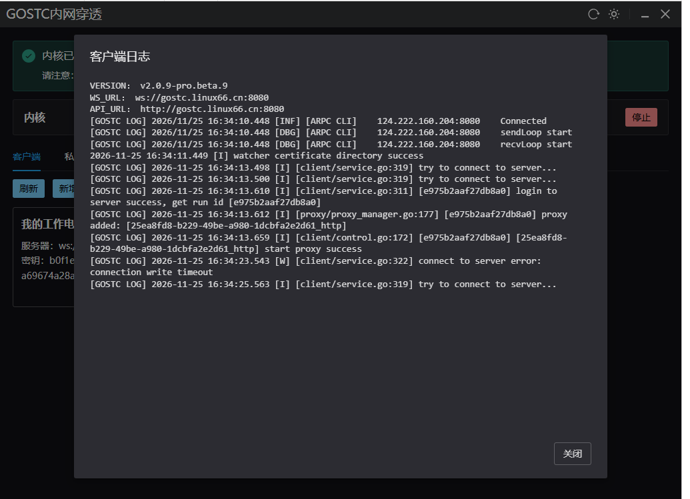
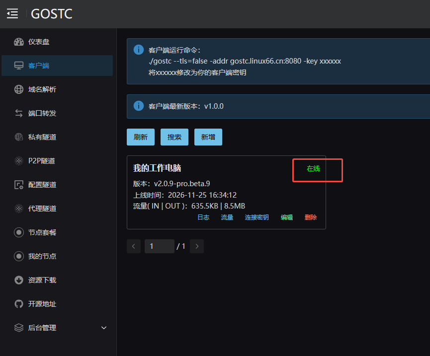
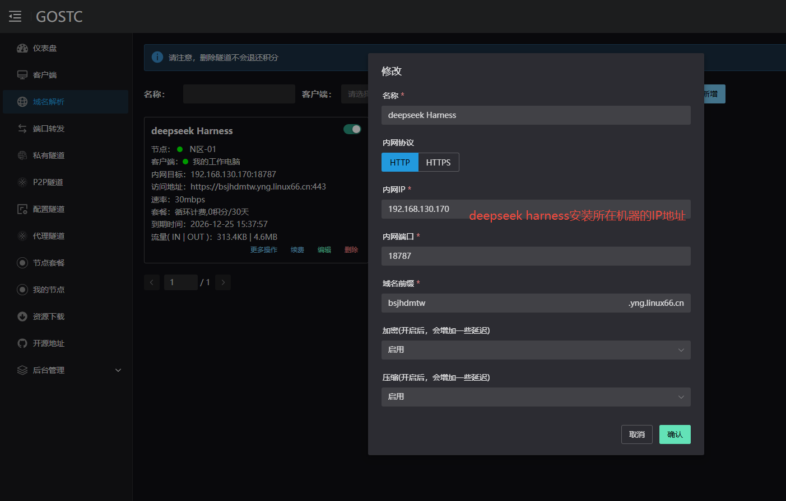
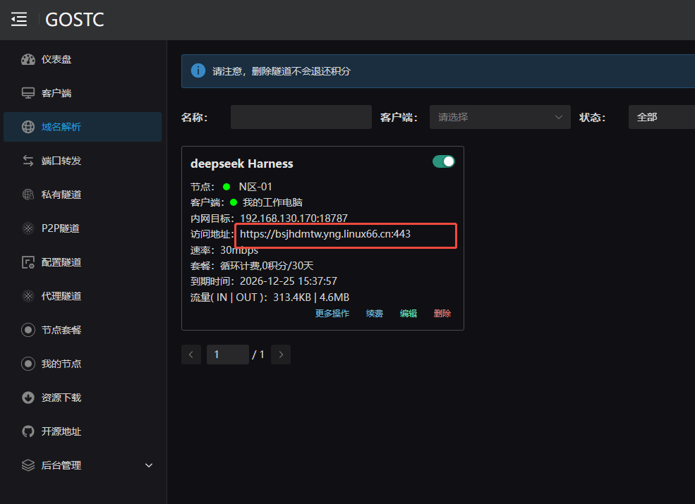
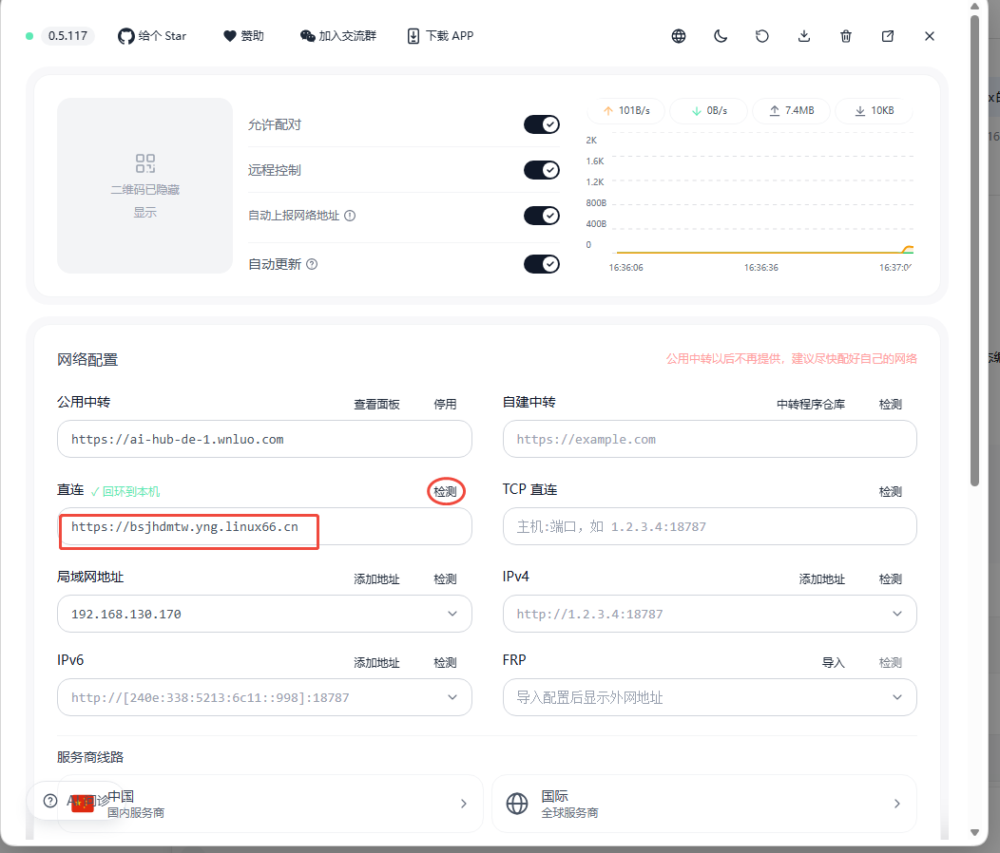
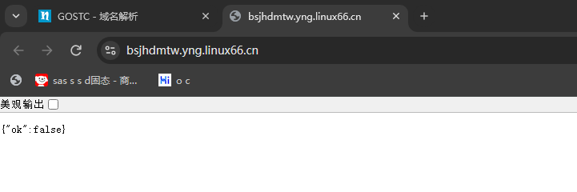

# DeepSeek Harness AI-HUB 插件移动端公网直连教程

> 目标：让 DeepSeek Harness 跑在家里/公司内网的电脑上，用 GOSTC 把 **AI-HUB 移动端插件**（`dsh-mobile-plugin`）的服务端口映射成一个公网 HTTPS 域名，手机上的 AI-HUB App 用流量就能直接连回来——不需要公网 IP，不需要路由器端口映射，也不依赖公用中转。
>
> 文中服务器地址、域名后缀、内网 IP、端口均为**示例**，请替换为你自己站点与机器的实际值。界面以 `dsh-mobile-plugin` 0.5.x 为准，不同版本可能略有差异。

## 一、方案原理

```
手机 AI-HUB App（4G/5G 流量）
        │  HTTPS 443
        ▼
https://bsjhdtmw.yng.linux66.cn        ← GOSTC 云端节点
        │  长连接隧道（客户端主动外连，无需公网 IP、无需路由器端口映射）
        ▼
GOSTC 客户端（运行 Harness 的那台电脑）
        │  转发到 192.168.130.170:18787
        ▼
AI-HUB 移动端插件（dsh-mobile-plugin）的移动端服务
```

关键点：

- 映射的是插件的**移动端服务端口**（默认 `18787`，以插件面板「局域网端口」为准）。它只开放手机需要的移动 API（`/api/mobile/v1/*`），不暴露 shell、系统设置与任意文件写入。
- 用浏览器打开这个域名只会看到一段 JSON，这是正常的——完整功能在手机 AI-HUB App 里，不在浏览器里。
- 隧道由**客户端主动向云端发起**，内网机器不需要公网 IP，也不用手动做路由器端口映射。
- 公网域名 → 云端节点 → 客户端 → `内网IP:端口`，任何一段断了外网都连不上。排查顺序永远是：**客户端在线 → 隧道开关为绿 → 本机端口在监听 → 域名可访问 → App 配对成功**。
- AI-HUB 的**公用中转已停止提供**，公网直连（或其它自建线路）不是可选项，是必做项。

## 二、前置准备

| 项目 | 要求 | 怎么确认 |
| --- | --- | --- |
| GOSTC 账号与客户端 | 已注册，并下载安装客户端 | 见 [客户端安装](../client-install.md) |
| 客户端连接密钥 | 一串 UUID，形如 `b0f1e3c2-xxxx-xxxx-xxxx-xxxxxxxxxxxx` | 控制台「客户端」页面复制 |
| Harness 已运行 | 桌面端已启动 | 任务栏/主界面可见 |
| AI-HUB 插件已安装 | 在 Harness **设置 → 插件** 搜索 `dsh-mobile-plugin` 安装 | 安装后设置里出现「移动端」入口 |
| 手机已装 AI-HUB App | Android / iOS | 下载链接见下 |
| 本机内网 IP | 示例为 `192.168.130.170` | `ipconfig` |
| 服务端口 | 默认 `18787`，以插件面板「局域网端口」为准 | 见下方命令 |

AI-HUB App 下载：

- **Android**：[分发下载](https://app.wnluo.com/api/public/apps/14/download-latest) 或 [GitHub APK](https://github.com/WNLUO/dsh-mobile-plugin/releases/latest/download/ai-hub-android.apk)
- **iOS**：[App Store](https://ai-hub.wnluo.com/ios) 或 [TestFlight 测试版](https://testflight.apple.com/join/4fn5PCMD)

确认本机端口确实在监听（Windows 命令行）：

```bat
netstat -ano | findstr 18787
ipconfig
```

能看到 `LISTENING` 才说明插件的移动端服务起来了；`ipconfig` 里记下当前网卡的 IPv4 地址，后面「内网IP」就填它。如果你在面板里改过端口，全文的 `18787` 都换成改后的值。

## 三、第一步：配置并启动 GOSTC 客户端

### 3.1 新增客户端

打开 GOSTC 客户端 → 「客户端」标签页 → 点「新增」，按下表填写：

| 字段 | 填写内容 |
| --- | --- |
| 名称 | `我的工作电脑`（随意，便于辨识） |
| 密钥 | 控制台复制的客户端连接密钥 |
| 服务器 | 下拉选 **启用TLS**，地址填 `gostc.shop`（替换为你站点的服务端地址） |



> 注意：连接平台 `gostc.shop` 要选**「启用TLS」**；地址直接填域名，别自己加 `https://` 或 `wss://`，否则会一直连不上。自建服务端未启用 SSL 时才选「禁用TLS」。

已有条目点「编辑」改的是同一个表单，字段完全一致：



### 3.2 启动内核 + 打开开关

1. 顶部「内核」卡片应为 **内核已启动**，按钮显示「停止」（说明已经在跑，别再去点它）。
2. 客户端卡片右上角的开关拨到**绿色**。
3. 开关变绿 ≈ 客户端已上线。



> 卸载/删除客户端前，请先「卸载内核」，避免残留。

### 3.3 看日志确认隧道建立

点卡片上的「日志」，正常日志长这样：

```
[GOSTC LOG] try to connect to server...
[GOSTC LOG] login to server success, get run id [e975b2aaf27db8a0]
[GOSTC LOG] proxy added: [25ea8fd8-...-http]
[GOSTC LOG] start proxy success
```

出现 `login to server success` + `start proxy success` 就代表客户端这一侧彻底通了。



日志里出现下面这行则是网络问题，不是配置问题：

```
connect to server error: connection write timeout
```

处理办法：关掉系统代理 / VPN 再试，或换一个网络（手机热点）验证是不是当前网络出站被拦。

### 3.4 命令行方式（可选）

不想用图形界面时，等价命令是：

```bash
./gostc --addr gostc.shop --key 你的客户端密钥
```

参数与界面一一对应：`--addr` = 服务器，`--key` = 密钥，TLS 默认开启（相当于界面选「启用TLS」）。详见 [客户端安装](../client-install.md)。

### 3.5 在控制台交叉确认客户端在线

登录控制台 → 左侧「客户端」，卡片右上角显示绿色「**在线**」，并且版本、上线时间、流量都有数据，说明客户端确实连上了云端。这一页同时也是复制密钥、查看运行命令的入口。



## 四、第二步：在控制台建一条「域名解析」隧道

登录 GOSTC 网页控制台 → 左侧「域名解析」→ 点「新增」，按下表填写：

| 字段 | 值 | 说明 |
| --- | --- | --- |
| 名称 | `deepseek harness` | 任意 |
| 内网协议 | **HTTP** | 插件的移动端服务是 HTTP；HTTPS 由云端在 443 上终结 |
| 内网IP | `192.168.130.170` | **Harness 所在机器的内网 IP**，不是 `127.0.0.1` |
| 内网端口 | `18787` | 插件面板「局域网端口」显示的监听端口 |
| 域名前缀 | `bsjhdtmw` | 自定义，冲突就换一个 |
| 域名后缀 | `yng.linux66.cn` | 下拉选择站点提供的可用后缀 |
| 加密 | 启用 | 建议开启，会增加一点延迟 |
| 压缩 | 按需 | 会增加一点延迟 |



确认后列表里会出现一条卡片，核对三项：

```
内网目标: 192.168.130.170:18787
访问地址: https://bsjhdtmw.yng.linux66.cn:443   ← 这就是最终公网入口
节点:     北区-01    速率: 30mbps
```



三个易踩的坑：

1. **内网IP 别填 `127.0.0.1`**。填回环地址大概率 502，统一填 Harness 所在机器的内网 IP。
2. **端口必须与插件实际监听端口一致**。下一步会在插件面板开启「固定端口」，防止端口被占时自动换号导致隧道失效。
3. **注意到期时间**。示例套餐是 30 天循环，到期不续费域名会直接不可用。

> 「域名解析」自带域名和 HTTPS，最适合给这种 Web 服务用；功能详解见 [功能说明](../features.md)。

## 五、第三步：配置 AI-HUB 插件的网络配置

打开 DeepSeek Harness → **设置 → 移动端 → 打开配置页面**，进入「网络配置」面板：



1. 打开 **远程控制** 总开关，打开 **允许配对**（允许新设备配对）——远程访问必须开这两项。
2. **局域网端口** 保持默认 `18787`，并开启 **固定端口**：使用外部内网穿透时请开启；端口被占时保留原端口并提示，不会自动换号。
3. 在 **直连** 一栏的「直连地址」输入框填：

   ```
   https://bsjhdtmw.yng.linux66.cn
   ```

   > 只填域名，**不要带 `:443`、不要带路径、不要带结尾斜杠**。带端口号会导致检测失败。

4. 点 **检测回环**，出现「**✓ 回环到本机**」才说明这个公网地址确实绕回了本机的插件服务：
   - 「连得上，但不是本机」→ 地址指到了别的设备，回第四步核对隧道的内网 IP。
   - 「连不上，请检查地址、端口或反代路径」→ 回第一、二步排查客户端与隧道。
5. 打开 **自动上报网络地址**：插件会把当前地址加密上报给「总控」（地址目录服务）。手机换了网络、或电脑地址变化后，手机凭设备令牌就能找回最新入口；总控只保存密文，看不到具体地址。
6. **局域网地址** 保持为本机内网 IP：手机和电脑在同一 Wi-Fi 时走局域网直连更快，不必绕公网。
7. 「公用中转」已停止提供，不要再依赖它。

填完保存，电脑侧就完成了。

## 六、第四步：手机 AI-HUB App 配对

1. 打开 AI-HUB App → 「添加设备」。
2. 扫插件面板上的**配对二维码**（或手输配对码）。二维码里带着当前可连的地址；**改过直连地址后要重新生成一张二维码再扫**，别对着旧码反复重试。
3. 在电脑侧选择权限档位：
   - **完整（full）**：能安装插件、读写登记过的工作区、改模型与渠道等配置。
   - **审批（approve）**：能看会话和文件、替你点审批和回答提问，但不直接写文件、不改配置。
   - **只读（readonly）**：只能看会话内容和文件，不能发消息、不能审批。

   日常远程推荐「审批」；确实需要在手机上改配置时再用「完整」。
4. 配对成功后，手机会先试选中的那条线路，试不通自动换下一条；可以在面板地址列表里把公网直连地址设为「手机优先用这条」。

> 配对码是一次性邀请，放久会失效；配对失败就在电脑上重新生成新码尽快扫。配对码与二维码不要发到公屏或群里。

## 七、第五步：外网验证

**关键：一定要用「外网」验证，别在本机浏览器里自测**，否则你验证的是回环，不是隧道。

1. 手机关掉 Wi-Fi，用 4G/5G 流量。
2. 浏览器访问 `https://bsjhdtmw.yng.linux66.cn`，看到 JSON（如 `{"ok":false}`）——**这就是成功**。根路径本身没有业务接口，插件用一段 JSON 告诉你「我收到了请求，但这里没有这个接口」。

   

3. 更准确的体检口（电脑上执行也可以）：

   ```bat
   curl https://bsjhdtmw.yng.linux66.cn/api/mobile/v1/health
   ```

   应返回带 `service` 和版本号的 JSON。这是移动 API 的体检口，不带 token 也能回。
4. 验证鉴权生效：不带 token 访问 `/api/mobile/v1/status`，应返回 **401** JSON。若直接回了数据，说明暴露面不对，先别用，回头检查。
5. 端到端实测：打开 AI-HUB App，能看到会话列表、发一条消息、回复逐块流式到达；再点一次审批、传一个文件。这些都正常，才算真正打通。

判断标准：

- 返回 **JSON** → 请求已经穿透到本机插件，隧道 OK；
- 返回 GOSTC 错误页 / 502 / 504 / 该站点无法访问 → 隧道没通，去查内网 IP、端口、客户端是否在线。

## 八、常见问题排查

| 现象 | 最可能的原因 | 处理办法 |
| --- | --- | --- |
| 客户端日志反复 `connection write timeout` | 本机网络出站被拦、开了代理/VPN | 关代理后重试；换手机热点对比；`telnet gostc.shop 443` 测通 |
| 客户端一直连不上，日志无 `login to server success` | 密钥填错，或服务器选了 TLS | 重新复制密钥；服务器用「禁用TLS + 服务端地址」 |
| 域名访问 502 / 504 | 内网 IP 或端口填错、Harness/插件未启动 | 本机 `netstat -ano \| findstr 18787` 看监听；确认内网 IP 是当前网卡地址 |
| 昨天能用今天不行 | 路由器重启后 DHCP 换了 IP | 隧道里改成新 IP，或给这台机设静态 IP / 路由器 IP 绑定 |
| 隧道端口突然对不上 | 插件端口被占后自动换号 | 面板开启「固定端口」，隧道端口与面板「局域网端口」保持一致 |
| 「检测回环」不通过，但浏览器能打开 | 地址填了 `:443`、路径或结尾 `/` | 只填 `https://域名` |
| 检测提示「连得上，但不是本机」 | 隧道指向了别的机器 | 核对隧道内网 IP 是否为 Harness 所在机器 |
| 扫码提示「二维码没有可用的连接地址」 | 电脑侧没配好可连地址、隧道没连上 | 配好直连地址、确认隧道在线后，重新生成二维码再扫 |
| 配对码不对 / 电脑拒绝新设备 | 码过期，或「允许配对」没开 | 重新生成二维码尽快扫；打开「允许配对」 |
| 页面能开但 App 连不上 | 「远程控制」「允许配对」没开 | 回到网络配置打开两个开关再试 |
| 到期后整条隧道失效 | 套餐到期 | 控制台续费，续费后开关重新打开 |
| 速度慢、延迟高 | 节点远、套餐带宽有限、加密压缩开销 | 换更近节点；关掉压缩；同 Wi-Fi 时优先走局域网 |

更多 GOSTC 侧问题见 [常见问题](../faq.md)。

## 九、安全与维护建议

公网域名一旦可访问，等于把插件的移动端服务挂在了互联网上，务必注意：

1. **别把客户端密钥发群里/截图外传**。密钥泄露等于别人能借你的机器做隧道，控制台可重置。
2. **不长期挂着**。只在需要远程时打开隧道开关，用完关掉（开关拨回灰色即可，不影响配置）。
3. **配对码不上公屏**。权限档位按需选「只读/审批」；设备凭据可在插件面板单独吊销，也能一次全撤。
4. **定期看流量**。控制台卡片有 `流量(IN | OUT)`，异常增长说明有人在扫或连。
5. **换域名前缀**。前缀是可猜的短串（如 `bsjhdtmw`），担心被扫就换成长一点的随机串。
6. **到期提醒**。把续费时间记进日历，以自己控制台显示的到期时间为准。

## 十、一页速查

```
本机：  netstat -ano | findstr 18787   → 有 LISTENING
        ipconfig                       → 记下 IPv4
客户端：密钥 + 禁用TLS + 服务端地址，开关拨绿，日志见 start proxy success
控制台：域名解析 → 新增 → HTTP / 内网IP / 18787 / 前缀 / 后缀
插件：  设置 → 移动端 → 网络配置
        远程控制 + 允许配对 + 固定端口
        直连地址填 https://前缀.后缀 → 检测回环 ✓ → 自动上报打开
手机：  AI-HUB App → 添加设备 → 扫配对二维码 → 选权限档位
验证：  手机关 Wi-Fi 走流量打开域名 → 看到 JSON 即通
        /api/mobile/v1/health 回 service/版本；无 token 访问 /status 回 401
        App 看到会话、流式回复正常 → 端到端打通
```